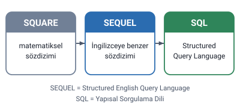
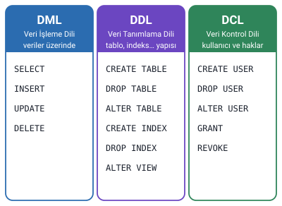

### SQL nedir

**SQL** (Structured Query Language), Türkçesiyle **Yapısal Sorgulama Dili**, veritabanları üzerinde karmaşık sorgular yapmak için tasarlanmış bir dildir.

SQL ile yalnızca veritabanı üzerinde işlem yapılabilir. SQL ile:

- veritabanına kayıt eklenebilir,
- var olan kayıtlar değiştirilebilir,
- kayıtlar silinebilir,
- kayıtlardan listeler oluşturulabilir.

> **Ek:** "Yalnızca veritabanı üzerinde işlem yapılabilir" sözü, SQL'in bir programlama dili gibi her işe değil, veritabanındaki verilere yönelik bir dil olduğunu anlatır. Ekran tasarımı ya da dosya işlemleri gibi işler SQL ile yapılmaz.

### SQL'in tarihçesi

Veritabanı yaklaşımıyla birlikte bir veri sorgulama diline ya da aracına ihtiyaç duyuldu.

1. İlk başta matematiksel bir sözdizimine sahip olan **SQUARE** adlı bir dil geliştirildi.
2. Geniş kullanıcı kitlelerinin kolay kullanabilmesi için matematiksel sözdizimli SQUARE'den vazgeçildi ve İngilizceye benzer sözdizimine sahip bir dil oluşturuldu. Bu dile **SEQUEL** (Structured English Query Language) adı verildi.
3. Daha sonra SEQUEL, İngilizce söylenişine paralel olarak **SQL** diye adlandırıldı.

> **Ek:** Kaynaklarda SEQUEL adının bırakılma nedeni olarak bu adın İngiliz Hawker Siddeley şirketinin ticari markası olması gösterilir. SQL bugün hem harf harf ("es-kyu-el") hem de "sikuel" diye okunur.

### SQL dilini kullanan veritabanları

Hocanın listesi: MySQL, Mssql, PostgreSQL, Microsoft SQL Server, Oracle, Firebird.

> **Dikkat:** Listede "Mssql" ile "Microsoft SQL Server" ayrı ayrı yazılmış; ikisi aynı üründür. Mssql, Microsoft SQL Server'ın kısa adıdır.

### SQL komut grupları

SQL komutları üç gruba ayrılır:

1. Veri İşleme Dili (**DML**, Data Manipulation Language)
2. Veri Tanımlama Dili (**DDL**, Data Definition Language)
3. Veri Kontrol Dili (**DCL**, Data Control Language)

#### Veri işleme dili (DML)

Bir tablodaki **veriler** üzerinde sorgulama, ekleme, güncelleme ve silme işlemlerini gerçekleştirir.

Komutları: `SELECT`, `INSERT`, `UPDATE`, `DELETE`

#### Veri tanımlama dili (DDL)

Sıfırdan tablo oluşturma, tablo üzerinde değişiklik yapma, indeks oluşturma ve silme işlemlerini gerçekleştirir.

Komutları: `CREATE TABLE`, `DROP TABLE`, `ALTER TABLE`, `CREATE INDEX`, `DROP INDEX`, `ALTER VIEW`

#### Veri kontrol dili (DCL)

Kullanıcılara veritabanı üzerinde bazı **haklar verme** ya da verilen hakları **geri alma** gibi işlemlere olanak tanıyan komutları içerir.

Komutları: `CREATE USER`, `DROP USER`, `ALTER USER`, `GRANT`, `REVOKE`

> **Dikkat:** DML tablodaki **verilerle**, DDL ise tablo ve indeks gibi nesnelerin **yapısıyla** ilgilenir. En çok karıştırılan ikili: `DELETE` tablodaki **kayıtları** siler (DML); `DROP TABLE` **tablonun kendisini** siler (DDL). Benzer biçimde `UPDATE` kayıtları değiştirir (DML), `ALTER TABLE` tablonun yapısını değiştirir (DDL). Hak vermek `GRANT`, geri almak `REVOKE`'tur (DCL).

> **Ek:** Bazı kaynaklar `SELECT`'i ayrı bir grupta (DQL, veri sorgulama dili), `CREATE USER` gibi komutları da DDL'de sayar. Bu notta ve sorularda hocanın sınıflandırması esas alındı.
