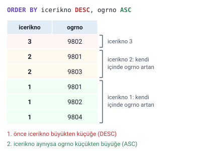
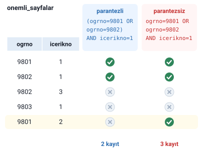
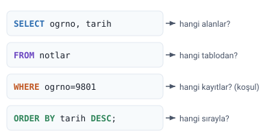

### Örnek tablolar (Ek)

> **Ek:** Hocanın örnekleri bir "Görev 10" veritabanındaki tablolara dayanıyor, ama bu tabloların içeriği slaytlarda verilmiyor. Sorguların ne döndürdüğünü görebilmek için aşağıda, sorgulardaki tablo ve alan adlarıyla kurulmuş küçük bir örnek veri var. Adların çoğu "Veritabanı Yapısı: Tablo, Kayıt, Alan" konusundaki öğrenci tablosundan alındı; numaralar, notlar ve tarihler örnek olarak seçildi. Bu konudaki bütün sonuç tabloları bu veriyle, sorgular gerçekten çalıştırılarak elde edildi.

kullanici_bilgileri tablosu:

| ogrno | ad | soyad |
| --- | --- | --- |
| 9801 | Ayşe | Öztürk |
| 9802 | Sema | Özdemir |
| 9803 | Serdar | Gülpınar |
| 9804 | Mehmet | Efe |
| 9805 | Zerrin | Polat |
| 9806 | Ulviye | Kubalı |
| 9807 | Sema | Öztürk |

notlar tablosu (öğrencinin hangi içerikten, hangi tarihte, kaç aldığı):

| ogrno | icerikno | notu | tarih |
| --- | --- | --- | --- |
| 9801 | 1 | 70 | 01.03.2009 |
| 9802 | 1 | 85 | 02.03.2009 |
| 9801 | 2 | 60 | 04.03.2009 |
| 9803 | 2 | 90 | 03.03.2009 |
| 9802 | 3 | 45 | 27.02.2009 |
| 9804 | 1 | 75 | 05.03.2009 |

onemli_sayfalar tablosu (hangi öğrencinin hangi içeriği önemli sayfa yaptığı):

| ogrno | icerikno |
| --- | --- |
| 9801 | 1 |
| 9802 | 1 |
| 9802 | 3 |
| 9803 | 1 |
| 9801 | 2 |

### SELECT ile kayıt çekmek

SQL dilinde bir tablodan kayıt çekmek için **SELECT** komutu kullanılır:

```sql
SELECT * FROM tablo_adi
```

Buradaki `*`, tablonun **bütün alanları** demektir. `FROM`'dan sonra kayıtların çekileceği tablonun adı yazılır.

Hocanın örneği: veritabanındaki bütün kullanıcı bilgilerini görüntülemek için:

```sql
SELECT * FROM kullanici_bilgileri;
```

Örnek veride bu sorgu, kullanici_bilgileri tablosunun yedi kaydının hepsini, üç alanıyla birlikte getirir.

Hocanın alıştırması: "Öğrencilerin tümü tarafından yazılımda alınan notların tamamını listeleyin." Cevabı slaytta verilmemiş; notlar, sonraki slaytlarda kullanılan `notlar` tablosunda tutulduğuna göre cevap:

```sql
SELECT * FROM notlar;
```

> **Ek:** Sorgunun sonundaki noktalı virgül (`;`) sorgunun bittiğini gösterir. Hocanın genel kalıplarında bazen yazılmamış. Access ve SQL Server tek sorguda noktalı virgülü zorunlu tutmaz, ama yazmak iyi alışkanlıktır.

### Belli alanları listelemek

Tablodaki yalnızca belli alanlara ait verileri listelemek için `*` yerine alan adları virgülle yazılır:

```sql
SELECT alanadi1,alanadi2 FROM tablo_adi;
```

Hocanın örneği: notlar tablosunda yalnızca notu alan öğrencinin numarasını ve notu aldığı tarihi listelemek için:

```sql
SELECT ogrno,tarih FROM notlar;
```

| ogrno | tarih |
| --- | --- |
| 9801 | 01.03.2009 |
| 9802 | 02.03.2009 |
| 9801 | 04.03.2009 |
| 9803 | 03.03.2009 |
| 9802 | 27.02.2009 |
| 9804 | 05.03.2009 |

> **Ek:** `ORDER BY` yazılmadığında kayıtların hangi sırayla geleceği garanti değildir; çoğu zaman eklenme sırasıyla gelir. Belli bir sıra isteniyorsa sıralama açıkça yazılır.

### ORDER BY ile sıralamak

Verileri listelerken belli bir alandaki değerlere göre sıralamak için **ORDER BY** kullanılır:

```sql
SELECT * FROM tablo_adi ORDER BY alan1;
```

Hocanın örneği: alınan notları tarihe göre sıralamak için:

```sql
SELECT * FROM notlar ORDER BY tarih;
```

Bu kod şöyle de yazılabilir:

```sql
SELECT * FROM notlar ORDER BY tarih ASC;
```

**ASC** artan sıra (küçükten büyüğe, eskiden yeniye) demektir ve yazılmasa da varsayılan budur. Azalan sıra için **DESC** yazılır. Hocanın örneği: alınan notları tarihe göre azalan sırada sıralamak için:

```sql
SELECT * FROM notlar ORDER BY tarih DESC;
```

| ogrno | icerikno | notu | tarih |
| --- | --- | --- | --- |
| 9804 | 1 | 75 | 05.03.2009 |
| 9801 | 2 | 60 | 04.03.2009 |
| 9803 | 2 | 90 | 03.03.2009 |
| 9802 | 1 | 85 | 02.03.2009 |
| 9801 | 1 | 70 | 01.03.2009 |
| 9802 | 3 | 45 | 27.02.2009 |

> **Dikkat:** `ORDER BY tarih` ile `ORDER BY tarih ASC` aynı sonucu verir, çünkü ASC varsayılandır. Azalan sıra istendiğinde DESC **mutlaka** yazılmalıdır.

#### Birden fazla alana göre sıralamak

Verileri listelerken birden fazla alan esas alınabilir; her alanın yönü ayrı ayrı yazılır:

```sql
SELECT * FROM tabloadi ORDER BY alanadi1 DESC, alanadi2 ASC;
```

Hocanın örneği: alınan notları içerik numaralarına göre azalan, öğrenci numaralarına göre de artan sırada listelemek için:

```sql
SELECT * FROM notlar ORDER BY icerikno DESC, ogrno ASC;
```

| ogrno | icerikno | notu | tarih |
| --- | --- | --- | --- |
| 9802 | 3 | 45 | 27.02.2009 |
| 9801 | 2 | 60 | 04.03.2009 |
| 9803 | 2 | 90 | 03.03.2009 |
| 9801 | 1 | 70 | 01.03.2009 |
| 9802 | 1 | 85 | 02.03.2009 |
| 9804 | 1 | 75 | 05.03.2009 |

Önce `icerikno`'ya göre büyükten küçüğe (3, 2, 1) sıralanır. İçerik numarası aynı olan kayıtlar kendi aralarında `ogrno`'ya göre küçükten büyüğe sıralanır: içerik 2'de 9801 önce, 9803 sonra gelir.



> **Dikkat:** İkinci alan yalnızca birinci alanı **aynı** olan kayıtların kendi arasındaki sırayı belirler. Alanların yazılış sırası önemlidir: `ORDER BY ogrno ASC, icerikno DESC` bambaşka bir sıra verir.

### WHERE ile koşul

Tablodaki belli bir alanın bir koşula uymasına göre verileri listelemek için **WHERE** kullanılır:

```sql
SELECT * FROM tablo_adi WHERE alanadi1=koşul;
```

Hocanın örneği: yalnızca 9801 numaralı öğrencinin aldığı notları görüntülemek için:

```sql
SELECT * FROM notlar WHERE ogrno=9801;
```

| ogrno | icerikno | notu | tarih |
| --- | --- | --- | --- |
| 9801 | 1 | 70 | 01.03.2009 |
| 9801 | 2 | 60 | 04.03.2009 |

#### Metin koşulları ve tırnak

SQL kodlarında **metin** değerleri tırnak içinde yazılmalıdır; sayılar tırnaksız yazılır. Koşul metin ise:

```sql
SELECT * FROM tabloadi WHERE alanadi1="metin";
```

Hocanın örneği: kullanıcı bilgileri tablosundan yalnızca adı Sema olan öğrencilerin bilgilerini görüntülemek için:

```sql
SELECT * FROM kullanici_bilgileri WHERE ad="Sema";
```

| ogrno | ad | soyad |
| --- | --- | --- |
| 9802 | Sema | Özdemir |
| 9807 | Sema | Öztürk |

> **Dikkat:** Hoca metinleri **çift tırnakla** yazıyor; bu yazım Microsoft Access'te ve MySQL'de çalışır. Standart SQL'de ve **SQL Server**'da metin **tek tırnakla** yazılır: `WHERE ad='Sema'`. Microsoft belgesine göre SQL Server'da (varsayılan ayarla) çift tırnak içindeki yazı alan ya da tablo adı sayılır, bu yüzden `ad="Sema"` hata verir. Ayrıca slaytlardaki kıvrık tırnaklar (“ ”) hiçbir VTYS'de çalışmaz; kod yazarken düz tırnak kullanılır.

### AND ve OR

Tablodaki verileri **birden fazla koşulun hepsine** göre listelemek için **AND** kullanılır:

```sql
SELECT * FROM tablo_adi WHERE alanadi1="metin" AND alanadi2="metin";
```

Hocanın örneği:

```sql
SELECT * FROM kullanici_bilgileri WHERE ad="Sema" AND soyad="Öztürk";
```

| ogrno | ad | soyad |
| --- | --- | --- |
| 9807 | Sema | Öztürk |

> **Dikkat:** Slaytta bu örneğin açıklaması "adı Serdar Öztürk olan kullanıcılar" diye yazılmış, ama kodda `ad="Sema"` var. Kod, adı **Sema**, soyadı **Öztürk** olanları getirir. Adı Serdar Öztürk olanlar için `ad="Serdar" AND soyad="Öztürk"` yazılmalıdır (örnek veride böyle biri yok; sonuç boş gelir).

Tablodaki verileri **iki koşuldan en az birini** sağlama durumuna göre listelemek için **OR** kullanılır:

```sql
SELECT * FROM tablo_adi WHERE alanadi1="metin" OR alanadi2="metin";
```

Hocanın örneği: adı Serdar ya da soyadı Kubalı olan kullanıcıların bilgilerini listelemek için:

```sql
SELECT * FROM kullanici_bilgileri WHERE ad="Serdar" OR soyad="Kubalı";
```

| ogrno | ad | soyad |
| --- | --- | --- |
| 9803 | Serdar | Gülpınar |
| 9806 | Ulviye | Kubalı |

> **Dikkat:** AND, koşulların **hepsi** sağlanınca kaydı getirir; her AND eklendikçe sonuç **daralır** ya da aynı kalır, hiç genişlemez. OR, koşullardan **biri** sağlanınca getirir; her OR eklendikçe sonuç **genişler** ya da aynı kalır, hiç daralmaz.

#### Parantezli koşullar

"Hem … hem de … veya …" koşulunu içeren sorgular da olabilir; hangi koşulların birlikte değerlendirileceği parantezle belirtilir:

```sql
SELECT * FROM tablo_adi WHERE (alanadi1="metin" OR alanadi2="metin") AND alanadi3="metin";
```

Hocanın örneği: öğrenci numarası 9801 ya da 9802 olup 1 numaralı içeriği önemli sayfa yapan kullanıcılar varsa listelemek için:

```sql
SELECT * FROM onemli_sayfalar WHERE (ogrno=9801 OR ogrno=9802) AND icerikno=1;
```

| ogrno | icerikno |
| --- | --- |
| 9801 | 1 |
| 9802 | 1 |

> **Dikkat:** Parantez yazılmazsa sonuç değişir. SQL'de AND, OR'dan **önce** değerlendirilir; `WHERE ogrno=9801 OR ogrno=9802 AND icerikno=1` yazılırsa bu, `ogrno=9801 OR (ogrno=9802 AND icerikno=1)` anlamına gelir. Örnek veride bu sorgu 9801'in 2 numaralı içeriğini de getirir (3 kayıt). Hocanın özetindeki `(a AND b) OR c` ile `a AND (b OR c)` ikilisi de aynı noktayı gösterir: parantezin yeri sonucu değiştirir.



> **Dikkat:** Slayttaki örnekte `ogrno=9801OR` yazılmış; `9801` ile `OR` arasında boşluk olmalıdır. Yukarıdaki kod buna göre düzeltildi.

### Özet: sorgunun parçaları

Hocanın özeti:

- `SELECT`: tüm alanlar (`*`) ya da belli alanlar
- `ORDER BY`: sıralama
- `ASC` / `DESC`: artan / azalan
- `WHERE`: koşul (sayı ya da "metin")
- `AND` / `OR`: birden çok koşul
- `(a AND b) OR c` ile `a AND (b OR c)`: parantez sonucu değiştirir

> **Dikkat:** Parçaların yazılış sırası sabittir: `SELECT` → `FROM` → `WHERE` → `ORDER BY`. `ORDER BY`, `WHERE`'den önce yazılamaz. Slaytlarda WHERE ile ORDER BY'ın birlikte kullanıldığı bir örnek yok; aşağıdaki şekildeki sorgu bu sırayı göstermek için yazıldı.


