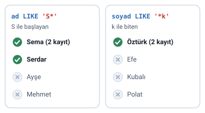
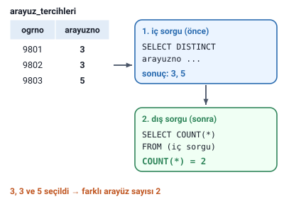
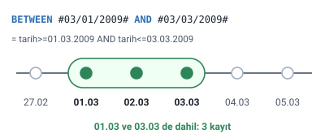
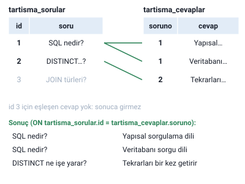

### Bu konudaki komutlar

Hocanın "SQL Komutlar 2" notunda altı komut var: **LIKE**, **DISTINCT**, **COUNT**, **iç içe SELECT** kullanımı, **BETWEEN** ve **INNER JOIN**.

> **Dikkat:** Bu nottaki örnekler **Microsoft Access** yazımıyla verilmiş: LIKE'ta joker olarak `*`, tarihlerde `#ay/gün/yıl#`. SQL Server, MySQL ve PostgreSQL'de yazım farklıdır; yazımın farklı olduğu başlıklarda (LIKE, Tarih yazımı) ayrıca belirtildi. Kalıplar hocanın yazımıyla korundu.

> **Ek:** Örneklerin sonuçları, "SELECT, ORDER BY ve WHERE" konusundaki örnek tablolar ve aşağıda verilen üç küçük tabloyla, sorgular çalıştırılarak elde edildi. Hocanın yazımı Access'e özgü olduğundan sorgular denenirken standart yazıma çevrildi.

### LIKE

SQL dilinde bir tablodan kayıtları çekerken "adı A ile başlayan", "soyadı B ile biten" tarzında sorgulamalar yapmak için **LIKE** kullanılır. Jokerin (`*`) yeri, aranan değerin başta mı sonda mı olduğunu belirler:

```sql
SELECT * FROM tablo_adi WHERE alanadi1 LIKE 'deger1*';
SELECT * FROM tablo_adi WHERE alanadi1 LIKE '*deger1';
```

- `'deger1*'`: deger1 ile **başlayan**
- `'*deger1'`: deger1 ile **biten**

Hocanın örneği: Görev 10'da oluşturulan veritabanında adı S ile başlayan kullanıcıların kimler olduğunu görüntülemek için:

```sql
SELECT * FROM kullanici_bilgileri WHERE ad LIKE 'S*';
```

| ogrno | ad | soyad |
| --- | --- | --- |
| 9802 | Sema | Özdemir |
| 9803 | Serdar | Gülpınar |
| 9807 | Sema | Öztürk |



> **Dikkat:** `*` jokeri Microsoft Access'in yazımıdır. SQL Server, MySQL ve PostgreSQL'de "herhangi sayıda karakter" jokeri **yüzde işaretidir**: `LIKE 'S%'`. Bu VTYS'lerde tek bir karakterin yerini alt çizgi (`_`) tutar.

### DISTINCT

SQL dilinde bir tablodan **tekrarlayan kayıtları yalnız bir kez** çekmek için **DISTINCT** kullanılır:

```sql
SELECT DISTINCT alanadi1 FROM tablo_adi
```

Hocanın örneği: önemli sayfa yapılan sayfaların neler olduğunu, her sayfa bir kez listelenecek şekilde görüntülemek için:

```sql
SELECT DISTINCT icerikno FROM onemli_sayfalar;
```

Örnek veride onemli_sayfalar tablosunun `icerikno` alanında 1, 1, 3, 1, 2 değerleri var. DISTINCT'siz sorgu bu beş değeri getirir; DISTINCT'li sorgu her değeri bir kez getirir (sonuç aşağıda küçükten büyüğe sıralanarak gösterildi):

| icerikno |
| --- |
| 1 |
| 2 |
| 3 |

> **Ek:** DISTINCT sonuçlarının sırası garanti değildir; sıralı istenirse sona `ORDER BY icerikno` eklenir.

### COUNT

SQL dilinde bir tablodaki **kayıtların toplam sayısını** belirlemek için **COUNT** kullanılır:

```sql
SELECT COUNT(*) FROM tablo_adi;
```

Hocanın örneği: kaç kullanıcı olduğunu belirlemek için:

```sql
SELECT COUNT(*) FROM kullanici_bilgileri;
```

Örnek veride sonuç **7**'dir. COUNT kayıtların kendisini değil, tek bir sayı döndürür.

### İç içe SELECT

Hocanın görevi: Görev 10'daki veritabanında **kaç farklı arayüz** seçimi yapıldığını belirleyin. Örneğin 3 öğrenci 3, 3 ve 5 numaralı arayüzü seçtiyse seçilen **farklı arayüz sayısı 2**'dir.

Hocanın çözümünde bir sorgunun içine, parantez içinde ikinci bir SELECT yazılmıştır:

```sql
SELECT Count(*) FROM arayuz_tercihleri WHERE id IN
(SELECT DISTINCT arayuzno FROM arayuz_tercihleri);
```

- İçteki sorgu (`SELECT DISTINCT arayuzno ...`), seçilmiş arayüz numaralarını tekrarsız listeler: 3 ve 5.
- `IN`, bir değerin bu listede **olup olmadığına** bakar.
- Dıştaki sorgu, `id` değeri bu listede olan kayıtları `Count(*)` ile sayar.

> **Ek:** Bu örnekteki gibi dış sorgudan bağımsız yazılmış bir iç sorgu önce çalışır ve bir liste üretir; dıştaki sorgu bu listeyi kullanır.

> **Dikkat:** Slayttaki sorguda dış sorgu da `arayuz_tercihleri` tablosunu sayıyor. Yazıldığı gibi bu, tercih kayıtlarından numarası (`id`) 3 ya da 5 olanları sayar; bu sayı farklı arayüz sayısı değildir, ona ancak tesadüfen eşit çıkabilir. Örnek veride (aşağıdaki tercih tablosu) hocanın sorgusu **1** döndürür, beklenen sonuç ise 2'dir. Amaçlanan sonucu veren yazımlar:
>
> `SELECT COUNT(*) FROM (SELECT DISTINCT arayuzno FROM arayuz_tercihleri);` (yine iç içe SELECT; yalnızca hocanın tablosunu kullanır ve Access'te çalışır. SQL Server'da, MySQL'de ve PostgreSQL'in 16'dan eski sürümlerinde kapanan parantezden sonra `AS t` gibi bir takma ad gerekir.)
>
> `SELECT COUNT(*) FROM arayuzler WHERE id IN (SELECT DISTINCT arayuzno FROM arayuz_tercihleri);` (dış sorgu arayüzlerin kendi tablosunu sayar; bu tablonun adı slaytta yok, `arayuzler` örnek addır)
>
> `SELECT COUNT(DISTINCT arayuzno) FROM arayuz_tercihleri;` (iç içe sorgu olmadan; Access bu yazımı desteklemez)
>
> Örnek veride üçü de **2** döndürür. Hocanın çözümündeki fikir (iç sorgu arayüzleri tekrarsız listeler, dış sorgu sayar) doğrudur; hata, dış sorgunun saydığı tablodadır. Aşağıdaki şekil ilk yazımı gösterir.



Bu başlıktaki örnek veri (Ek): arayüzlerin tablosu `arayuzler` (id 1–5) ve öğrencilerin tercihleri:

| id | ogrno | arayuzno |
| --- | --- | --- |
| 1 | 9801 | 3 |
| 2 | 9802 | 3 |
| 3 | 9803 | 5 |

### BETWEEN

SQL dilinde bir tablodaki kayıtlardan **belli aralıktakileri** seçmek için **BETWEEN** kullanılır. Hocanın ilk kalıbı aynı koşulu büyük-eşit ve küçük-eşit işaretleriyle yazar:

```sql
SELECT alanadi1,alanadi2 FROM tablo_adi WHERE tarih>=01.03.2009 AND tarih<=03.03.2009;
```

Hocanın örneği: 01.03.2009 ile 03.03.2009 tarihleri arasında not alan öğrencileri ve aldıkları notları listelemek için:

```sql
SELECT ogrno, notu FROM notlar WHERE tarih BETWEEN #03/01/2009# AND #03/03/2009#;
```

| ogrno | notu |
| --- | --- |
| 9801 | 70 |
| 9802 | 85 |
| 9803 | 90 |



> **Dikkat:** BETWEEN **sınırları da kapsar**. `tarih BETWEEN a AND b` ile `tarih>=a AND tarih<=b` aynı anlamdadır (Microsoft Access belgesi). Örnek veride 01.03 ve 03.03 tarihli notlar da listelenir; 27.02, 04.03 ve 05.03 tarihliler listelenmez.

#### Tarih yazımı

Hocanın notu: **Tarih: ay/gün/yıl**. `#03/01/2009#`, 3. ayın 1'i, yani **1 Mart 2009**'dur; `#03/03/2009#` ise 3 Mart 2009'dur.

> **Dikkat:** Türkiye'de alışılan gün.ay.yıl sırasıyla karıştırmayın: `#03/01/2009#` 3 Ocak değil, 1 Mart'tır. İlk kalıptaki tırnaksız `01.03.2009` yazımı tarih olarak okunmaz; tarih Access'te `#` işaretleri arasında (`#03/01/2009#`), diğer VTYS'lerde tırnak içinde yazılır.

> **Ek:** SQL Server, MySQL ve PostgreSQL'de tarih tırnak içinde ve yıl-ay-gün sırasıyla yazılır: `WHERE tarih BETWEEN '2009-03-01' AND '2009-03-03'`. SQL Server'ın datetime tipinde bu yazım dil ayarına göre farklı okunabilir; ayardan bağımsız yazım `'20090301'` biçimidir.

### INNER JOIN

İki farklı tablodaki kayıtları **eşleştirmek** amacıyla **INNER JOIN** kullanılır. `ON`'dan sonra iki tablonun hangi alanlarla eşleşeceği yazılır. Kalıpta alan adlarının önüne, hangi tabloya ait olduklarını göstermek için tablo adı ve nokta konmuş:

```sql
SELECT tablo1.alanadi1,tablo2.alanadi2 FROM tablo1
INNER JOIN tablo2 ON tablo1.alanadi3=tablo2.alanadi3;
```

Hocanın örneği: tartışma bölümünde sorulan soruları ve bu sorulara verilen cevapları listelemek için:

```sql
SELECT tartisma_sorular.soru,tartisma_cevaplar.cevap
FROM tartisma_sorular INNER JOIN tartisma_cevaplar ON
tartisma_sorular.id=tartisma_cevaplar.soruno;
```

Bu başlıktaki örnek veri (Ek):

tartisma_sorular:

| id | soru |
| --- | --- |
| 1 | SQL nedir? |
| 2 | DISTINCT ne işe yarar? |
| 3 | JOIN türleri nelerdir? |

tartisma_cevaplar:

| id | soruno | cevap |
| --- | --- | --- |
| 1 | 1 | Yapısal sorgulama dili |
| 2 | 1 | Veritabanı sorgu dili |
| 3 | 2 | Tekrarları bir kez getirir |

Sorgunun sonucu:

| soru | cevap |
| --- | --- |
| SQL nedir? | Yapısal sorgulama dili |
| SQL nedir? | Veritabanı sorgu dili |
| DISTINCT ne işe yarar? | Tekrarları bir kez getirir |



> **Dikkat:** INNER JOIN yalnızca **eşleşen** kayıtları getirir. 3 numaralı sorunun cevabı olmadığı için sonuçta yer almaz; iki cevabı olan 1 numaralı soru ise iki kez görünür. Eşleşme, cevap tablosundaki `soruno` ile soru tablosundaki `id` arasında kurulur.

> **Ek:** `tartisma_cevaplar.soruno` alanı, `tartisma_sorular.id`'ye bağlanan bir yabancı anahtar gibi çalışır ("Veri Bütünlüğü ve Kısıtlayıcılar" konusu).
